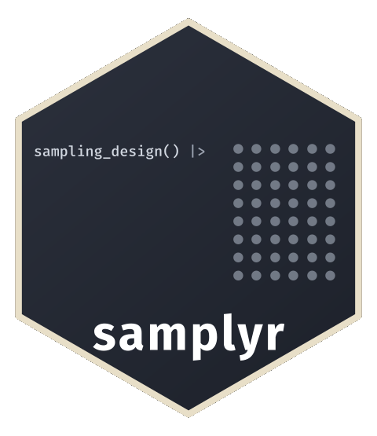

---
format:
  gfm:
    from: markdown-smart
    wrap: auto
    columns: 72
# Keep image URLs as written (quarto-dev/quarto-cli#6092).
default-image-extension: ""
---

<!-- README.md is generated from README.qmd. Please edit that file -->

```{r}
#| include: false
knitr::opts_chunk$set(
  collapse = TRUE,
  comment = "#>",
  fig.path = "man/figures/README-",
  out.width = "100%"
)
options(width = 65)
```

# samplyr 

<!-- badges: start -->
[](https://CRAN.R-project.org/package=samplyr)
[](https://gitlab.com/dickoa/samplyr/-/pipelines)
[](https://app.codecov.io/gl/dickoa/samplyr?branch=main)
<!-- badges: end -->

A tidy grammar for survey sampling in R. `samplyr` provides a minimal set of composable verbs for stratified, clustered, multi-stage, and multi-phase sampling designs with PPS methods, sample coordination, and panel rotation.

## Ecosystem Positioning

`samplyr` sits in the middle of a three-layer workflow:

- Use `svyplan` for planning (`n`, precision, power, allocation, budget).
- Use `samplyr` to specify designs, draw samples, and carry design metadata through fieldwork.
- Use `survey`/`srvyr` after data collection for estimation and inference.

These packages are complementary, not competing. Handoffs are explicit (for example, `svyplan` outputs can feed `draw(n = ...)`, and `samplyr` outputs convert via `as_svydesign()`, `as_svrepdesign()`, and `as_survey_design()`).

## Learn samplyr

Follow two articles: [Get started](https://dickoa.gitlab.io/samplyr/articles/introduction.html)
for the grammar and a complete three-stage fieldwork example, then
[Analyze the sample](https://dickoa.gitlab.io/samplyr/articles/survey-analysis.html)
for the handoff to `survey` and `srvyr`.

The book [Survey Sampling Design with R](https://www.ahmadoudicko.com/sampling-design-r-book/) covers planning with
`svyplan`, coordination, rotating panels and validation. The
[selection_methods reference](https://dickoa.gitlab.io/samplyr/reference/selection_methods.html)
compares the methods, and the [variance_estimation reference](https://dickoa.gitlab.io/samplyr/reference/variance_estimation.html)
gives how each one's variance is estimated. Serialization and design
semantics are references to consult as needed.

## Why samplyr?

`samplyr` is built around a simple idea: sampling code should read like its English description.

```{r}
#| label: overview
library(samplyr)
data(bfa_eas)

# "Stratify by region, proportionally allocate 500 samples, execute"
overview_sample <- sampling_design() |>
  stratify_by(region, alloc = "proportional") |>
  draw(n = 500) |>
  execute(bfa_eas, seed = 1)

overview_sample |>
  as.data.frame() |>
  dplyr::select(ea_id, region, households, .weight) |>
  head(4)
```

Consider a real survey design from Lohr (2022, Example 7.1), based on a 1991 study of bed net use in rural Gambia (D'Alessandro et al., 1994):

> Malaria morbidity can be reduced by using bed nets impregnated with insecticide, but this is only effective if the bed nets are in widespread use. In 1991, a nationwide survey was designed to estimate the prevalence of bed net use in rural areas of the Gambia (D'Alessandro et al., 1994).
>
> The sampling frame consisted of all rural villages of fewer than 3,000 people. The villages were **stratified by three geographic regions** (eastern, central, and western) and by **whether the village had a public health clinic (PHC)** or not. In each region **five districts were chosen with probability proportional to the district population**. In each district **four villages were chosen, again with probability proportional to census population**: two PHC villages and two non-PHC villages. Finally, **six compounds were chosen** more or less randomly from each village.

In `samplyr`, this three-stage stratified cluster design translates directly into code:

```{r}
design <- sampling_design(title = "Gambia bed nets") |>
  add_stage() |>
    stratify_by(region) |>
    cluster_by(district) |>
    draw(n = 5, method = "pps_brewer", mos = district_population) |>
  add_stage() |>
    stratify_by(phc) |>
    cluster_by(village) |>
    draw(n = 2, method = "pps_brewer", mos = village_population) |>
  add_stage() |>
    draw(n = 6)
design
```

The two MOS names distinguish district totals from village totals. This is
a design declaration. Execution also needs compatible registers and compound
listings. For a complete runnable example using bundled data, see
[A three-stage household sample](https://dickoa.gitlab.io/samplyr/articles/introduction.html#a-three-stage-household-sample)
in `vignette("introduction")`: communes, EAs and synthetic household
listings, followed by observations and survey export.

*Lohr, S. L. (2022). Sampling: Design and Analysis (3rd ed.). CRC Press.*

## Installation

```{r}
#| eval: false
# sondage, the sampling algorithms backend, is on CRAN
install.packages("sondage")

# Install svyplan (sample size, precision, power, and stratification)
pak::pkg_install("gitlab::dickoa/svyplan")

# Install samplyr
pak::pkg_install("gitlab::dickoa/samplyr")
```

## The Grammar

`samplyr` uses 5 verbs and 1 modifier:

| Function            | Purpose                               |
|---------------------|---------------------------------------|
| `sampling_design()` | Create a new sampling design          |
| `stratify_by()`     | Define stratification and allocation  |
| `cluster_by()`      | Define cluster/PSU variable           |
| `draw()`            | Specify sample size and method        |
| `execute()`         | Run the design on a frame             |
| `add_stage()`       | Delimit stages in multi-stage designs |

### Frame-Independent Design

`stratify_by()` and `cluster_by()` take bare column names. The design is stored as a specification and resolved only when a frame is available
(`validate_frame()`, `execute()`, `as_svydesign()`), so design specification stays separate from execution.

```{r}
#| label: frame-independent
design <- sampling_design() |>
  stratify_by(region, alloc = "proportional") |>
  cluster_by(ea_id) |>
  draw(n = 300)

sample <- execute(design, bfa_eas, seed = 2)
sample
```

## Quick Start

```{r}
#| label: quick-start
library(samplyr)
data(bfa_eas)

# Simple random sample
srs_smpl <- sampling_design() |>
  draw(n = 100) |>
  execute(bfa_eas, seed = 321)

srs_smpl

# Stratified proportional allocation
strata_smpl <- sampling_design() |>
  stratify_by(region, alloc = "proportional") |>
  draw(n = 300) |>
  execute(bfa_eas, seed = 12)

strata_smpl

# PPS cluster sampling
cluster_smpl <- sampling_design() |>
  cluster_by(ea_id) |>
  draw(n = 50, method = "pps_brewer", mos = households) |>
  execute(bfa_eas, seed = 123)

cluster_smpl
```

## Multi-Stage Sampling

Use `add_stage()` to define multi-stage designs. This example selects districts with PPS, then samples EAs within each:

```{r}
#| label: multi-stage
library(dplyr, warn.conflicts = FALSE)
data(zwe_eas)

# Add district-level measure of size
zwe_frame <- zwe_eas |>
  mutate(district_hh = sum(households), .by = district)

# Two-stage design: 10 districts, 5 EAs per district
sample <- sampling_design() |>
  add_stage(label = "Districts") |>
    cluster_by(district) |>
    draw(n = 10, method = "pps_brewer", mos = district_hh) |>
  add_stage(label = "EAs") |>
    draw(n = 5) |>
  execute(zwe_frame, seed = 12345)

sample
```

### Operational Sampling

Execute stages separately when fieldwork happens between stages:

```{r}
#| label: operational
design <- sampling_design() |>
  add_stage(label = "EA") |>
    stratify_by(urban_rural) |>
    cluster_by(ea_id) |>
    draw(n = 10, method = "pps_brewer", mos = households) |>
  add_stage(label = "HH") |>
    draw(n = 5)

# Execute stage 1 only
selected_eas <- execute(design, zwe_eas, stages = 1, seed = 1)
selected_eas

# ... fieldwork ...
# list all households in selected EAs
selected_eas_list <- selected_eas |>
  slice(rep(seq_len(n()), households)) |>
  mutate(hh_id = row_number())

# Execute stage 2
final_sample <- selected_eas |>
  execute(selected_eas_list, seed = 2)
final_sample
```

`selected_eas` still contains `design` plus the realized stage-1 selection.
Using it as the first argument continues that same multi-stage design. The
expanded listing is only the candidate frame for stage 2. Starting from a new
design with a prior `tbl_sample` as its frame instead denotes a new sampling
phase.

If `tidyr::uncount()` or another operation drops the listing's `tbl_sample`
class, keep using that plain object as the second argument above. `execute()`
recognizes its inherited sampling attributes and generated columns and refuses
to run it as a fresh frame from `design`, which would silently rerun stage 1.
Passing the intact `selected_eas` back as a frame of `design` also warns: that
call is supported as a new sampling phase, but it is not stage continuation.

## Selection Methods

Sixteen methods ship in three families:

- **Equal probability**: `srswor` (the default), `srswr`, `systematic`,
  `bernoulli`
- **PPS**, all requiring a measure of size: `pps_brewer`, `pps_systematic`,
  `pps_cps`, `pps_sampford`, `pps_poisson`, `pps_sps`, `pps_pareto`,
  `pps_multinomial`, `pps_chromy`
- **Balanced**: `cube`, plus the spatial `lpm2` and `scps`

`?selection_methods` is the reference: which take `n` or `frac`, which need
`mos`, `aux` or `spread`, which have a random rather than fixed sample size,
which accept permanent random numbers, and the paper behind each. Custom
methods registered with `sondage::register_method()` are used the same way.

## Allocation Methods

When stratifying, `n` in `draw()` has one of two meanings. Without an
allocation method it is the size taken in each stratum. With one, it is
the total for the stage, shared across the strata by the method.

| Method         | Description                                             |
|----------------|---------------------------------------------------------|
| (none)         | `n` is taken in each stratum                            |
| `equal`        | Splits the total `n` as evenly as the strata allow      |
| `proportional` | Proportional to stratum size                            |
| `neyman`       | Minimize variance (requires `variance`)                 |
| `optimal`      | Minimize cost-variance (requires `variance` and `cost`) |
| `power`        | Compromise allocation (requires `cv` and `importance`)  |

The same `n = 8` gives 24 units without a method and 8 with one.

```{r}
#| label: scope-of-n
frame <- data.frame(region = rep(c("A", "B", "C"), each = 10), id = 1:30)

per_stratum <- sampling_design() |>
  stratify_by(region) |>
  draw(n = 8) |>
  execute(frame, seed = 1)
table(per_stratum$region)

total <- sampling_design() |>
  stratify_by(region, alloc = "equal") |>
  draw(n = 8) |>
  execute(frame, seed = 1)
table(total$region)
```

Shares are rounded by largest remainder, which keeps the total. Equal
remainders go to the larger target first, then in label order, so the
three equal shares of 8 become 3, 3 and 2. `validate_frame()` states the
split before anything is drawn, and the `tied` column of
`frame_summary(detail = "pool")` marks the strata a tie decided.

At a later stage, both readings apply within each selected parent. A total
at stage 2 is a total per selected district, not one for the whole survey.
The printed design states the scope of every `n`.

```{r}
#| label: scope-of-n-stages
sampling_design() |>
  add_stage(label = "District") |>
    stratify_by(region) |>
    cluster_by(district) |>
    draw(n = 5) |>
  add_stage(label = "Village") |>
    stratify_by(urban, alloc = "equal") |>
    cluster_by(village) |>
    draw(n = 4)
```

### Sample Size Bounds

Use `min_n` and `max_n` in `draw()` to constrain stratum sample sizes when using allocation methods:

```{r}
#| label: bounds
data(bfa_eas_variance)

# Ensure at least 2 per stratum (minimum for variance estimation)
sampling_design() |>
  stratify_by(region, alloc = "neyman", variance = bfa_eas_variance) |>
  draw(n = 300, min_n = 2) |>
  execute(bfa_eas, seed = 321)
```

### Custom Allocation

For custom stratum-specific sizes or rates, pass a data frame to `n` or `frac` in `draw()`:

```{r}
#| label: custom-alloc
sizes_df <- data.frame(
  region = c("A", "B", "C"),
  n = c(2, 3, 4)
)

sample <- sampling_design() |>
  stratify_by(region) |>
  draw(n = sizes_df) |>
  execute(frame, seed = 42)
table(sample$region)
```

```{r}
#| label: neyman
# Neyman allocation
data(bfa_eas_variance)

sample <- sampling_design() |>
  stratify_by(region, alloc = "neyman", variance = bfa_eas_variance) |>
  draw(n = 300) |>
  execute(bfa_eas, seed = 4321)

sample
```

## Beyond the Basics

The verbs above compose across many common design families. These capabilities
extend the same grammar. The linked references describe their inputs and limits:

| Capability | How | Where |
|---|---|---|
| Balanced sampling | `draw(method = "cube", aux = ...)`, with `bound()` for hard count constraints | `?draw`, `?bound` |
| Spatially balanced | `draw(method = "lpm2" or "scps", spread = c(lon, lat))` | `?selection_methods` |
| Sample coordination | `draw(prn = ...)` with permanent random numbers, for overlap across waves | `?draw`, [Coordinate samples with permanent random numbers](https://www.ahmadoudicko.com/sampling-design-r-book/chapters/coordination.html) |
| Custom methods | `sondage::register_method()`, then `pps_<name>` or `balanced_<name>` | `?draw`, `sondage::register_method()` |
| Panel rotation | `execute(panels = 4)`, or `panel_stage =` to rotate units inside retained parents | `?panel_assignment`, `?rotation_program`, [Plan and run a rotating panel](https://www.ahmadoudicko.com/sampling-design-r-book/chapters/rotating-panels.html) |
| Replicated draws | `execute(reps = 5)` | `?execute` |
| Two-phase | pipe a `tbl_sample` into a new design's `execute()` | `vignette("survey-analysis")` |
| Indirect sampling | `share_weights()`, to estimate for a population linked to the one that was sampled | `vignette("design-semantics")` |
| Overlapping frames | `stack_frames()`, for two registers of one population | `vignette("survey-analysis")` |

The [variance_estimation reference](https://dickoa.gitlab.io/samplyr/reference/variance_estimation.html)
(`?variance_estimation`) compares first-order and joint probability quality and
variance estimators, with the stage and phase restrictions.

```{r}
#| label: beyond
#| eval: false
# Balanced on auxiliary totals, PPS on size
sampling_design() |>
  stratify_by(region, alloc = "proportional") |>
  draw(n = 300, method = "cube", mos = households,
       aux = c(population, area_km2)) |>
  execute(bfa_eas, seed = 24)

# Four rotation groups, five independent replicates
execute(design, bfa_eas, seed = 1, panels = 4)
execute(design, bfa_eas, seed = 42, reps = 5)

# Areas stay in the survey while the households inside them rotate
execute(two_stage_design, frame, seed = 1, panels = 4, panel_stage = 2)
```

## Survey Export

Convert to `survey` or `srvyr` for estimation. Here the Neyman sample
above estimates the mean number of households per EA:

```{r}
#| label: survey-export
svy <- as_svydesign(sample)
survey::svymean(~households, svy)

srvyr::as_survey_design(sample) |>
  dplyr::summarise(mean_households = srvyr::survey_mean(households))
```

For fixed-size PPS WOR stages, `as_svydesign()` uses the Brewer variance
approximation by default. Other selection families receive their own treatment.
`joint_expectation()` supplies exact or approximate pairwise quantities where
supported. An exact matrix does not guarantee a stable variance estimate or
accurate interval coverage. See
`vignette("survey-analysis")` for domain estimation, replicate weights, and the
method-by-method breakdown.

Both export verbs also take a `stack_frames()` collection, compositing
overlapping frames through `survey::multiframe()` or through a combined
replicate design that varies one frame at a time.


## Diagnostics

```{r}
#| label: diagnostics
summary(strata_smpl)
```

By default, each execution records a summary frame digest: a compact record of
the selection pools and chances the design resolved. `frame_summary()` returns
it as tibbles without needing the frame. Use `frame_digest = "none"` for the
lowest execution overhead, or `frame_digest = "full"` when downstream work
needs exact per-unit chances for unequal-probability element stages. The
companion package samplens, in development, draws the digest as a visual
sampling card. See `vignette("introduction")` for examples.

`execute()` also reports when the frame could not deliver what the design
asked for. A pool holding fewer units than the stage requested is selected
whole, which makes the design non-self-weighting, so this is a warning rather
than a silent adjustment. The `capped` column of
`frame_summary(sample, detail = "pool")` names the affected pools.
`?execution_conditions` lists every such condition and the payload it
carries.

## Checking a Design Before Drawing

A design can be checked against its frame before any unit is drawn, and
none of the checks below uses random numbers. A measure of size belongs to
the sampling unit, so it may repeat on every row of a cluster but must be
the same on each. At the final stage the frame rows are the units and need
no `cluster_by()`.

```{r}
#| label: check-before
villages <- data.frame(
  village = rep(c("v1", "v2", "v3", "v4"), c(6, 8, 5, 9)),
  household = 1:28
)
villages$size <- ave(villages$household, villages$village, FUN = length)

plan <- sampling_design() |>
  add_stage(label = "Village") |>
    cluster_by(village) |>
    draw(n = 2, method = "pps_brewer", mos = size) |>
  add_stage(label = "Household") |>
    draw(n = 6)

validate_frame(plan, villages)
frame_summary(plan, villages)[c("stage", "n_pools", "n_capped", "n_target")]
```

The `pool_key` column of `frame_summary(plan, villages, detail = "pool")`
names the short pools as `execute()` will. By default `execute()` takes
every unit of a short pool and warns. With `on_capped = "error"` in the
stage's `draw()`, it refuses before anything is drawn.

```{r}
#| label: check-strict
#| error: true
strict <- sampling_design() |>
  add_stage(label = "Village") |>
    cluster_by(village) |>
    draw(n = 2, method = "pps_brewer", mos = size) |>
  add_stage(label = "Household") |>
    draw(n = 6, on_capped = "error")

execute(strict, villages, seed = 1)
```

A requirement of the protocol, such as two villages and five households in
each, can be written as a design with the default method and compared with
the design to field. `compare_designs()` matches pools by the frame rows
they hold and compares each pool's take. The selection methods and
measures of size are listed side by side but do not enter the verdict.
With `level = "probabilities"` it compares the inclusion probability of
every unit instead.

```{r}
#| label: check-compare
requirement <- sampling_design() |>
  add_stage() |>
    cluster_by(village) |>
    draw(n = 2) |>
  add_stage() |>
    draw(n = 5)

compare_designs(requirement, plan, villages, key = household)
```

The plan takes six households in each village where the requirement asks
for five, and the comparison names the villages.

## Validation

For statistical validation on synthetic populations with known truths, see [Validation on synthetic populations](https://www.ahmadoudicko.com/sampling-design-r-book/chapters/validation.html) in the book. It combines deterministic invariants (weights, certainty, stage compounding) with Monte Carlo checks of bias, standard-error calibration, and coverage.

## Included Datasets

Derived and synthetic sampling frames for learning and testing:

| Dataset           | Description                                       | Rows    |
|-------------------|---------------------------------------------------|---------|
| `bfa_eas`         | Household budget and living-standards EA frame (Burkina Faso) | 44,570  |
| `zwe_eas`         | Demographic, health, and child-indicator EA frame (Zimbabwe)   | 107,250 |
| `ken_enterprises` | Establishment survey frame (Kenya)                | 17,004  |

Plus auxiliary data: `bfa_eas_variance`, `bfa_eas_cost`

## Comparison with SAS and SPSS

### SAS PROC SURVEYSELECT

```sas
proc surveyselect data=frame method=pps n=50 seed=12345;
  strata region;
  cluster school;
  size enrollment;
run;
```

```{r}
#| label: sas-compare
#| eval: false
sampling_design() |>
  stratify_by(region) |>
  cluster_by(school) |>
  draw(n = 50, method = "pps_brewer", mos = enrollment) |>
  execute(frame, seed = 1)
```

### SAS Allocation with Bounds

```sas
proc surveyselect data=frame method=srs n=500 seed=42;
  strata region / alloc=neyman var=variance_data allocmin=2 allocmax=100;
run;
```

```{r}
#| label: sas-bounds
#| eval: false
sampling_design() |>
  stratify_by(region, alloc = "neyman", variance = variance_data) |>
  draw(n = 500, min_n = 2, max_n = 100) |>
  execute(frame, seed = 2)
```

### SAS Rounding Control

```sas
proc surveyselect data=frame method=sys samprate=0.02 seed=2 round=nearest;
  strata State;
run;
```

```{r}
#| label: sas-rounding
#| eval: false
sampling_design() |>
  stratify_by(State) |>
  draw(frac = 0.02, method = "systematic", round = "nearest") |>
  execute(frame, seed = 3)
```

### SPSS CSPLAN

```spss
CSPLAN SAMPLE
  /PLAN FILE='myplan.csplan'
  /DESIGN STRATA=region CLUSTER=school
  /METHOD TYPE=PPS_WOR
  /SIZE VALUE=50
  /MOS VARIABLE=enrollment.
```

```{r}
#| label: spss-compare
#| eval: false
sampling_design() |>
  stratify_by(region) |>
  cluster_by(school) |>
  draw(n = 50, method = "pps_brewer", mos = enrollment) |>
  execute(frame, seed = 4)
```
